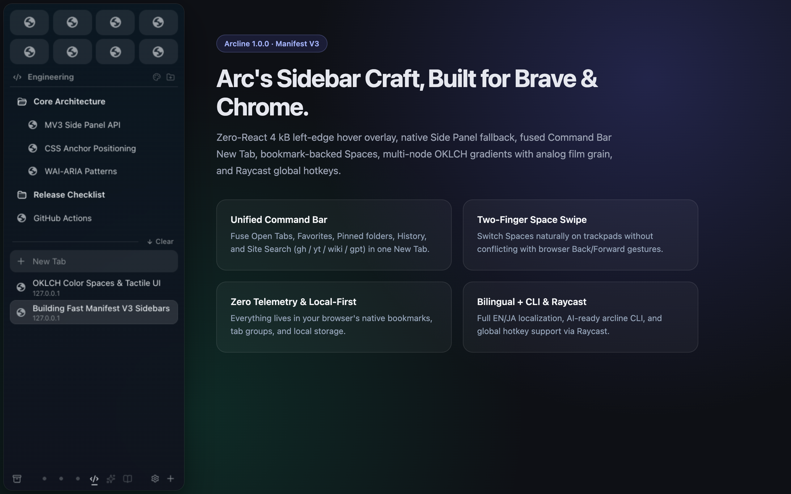
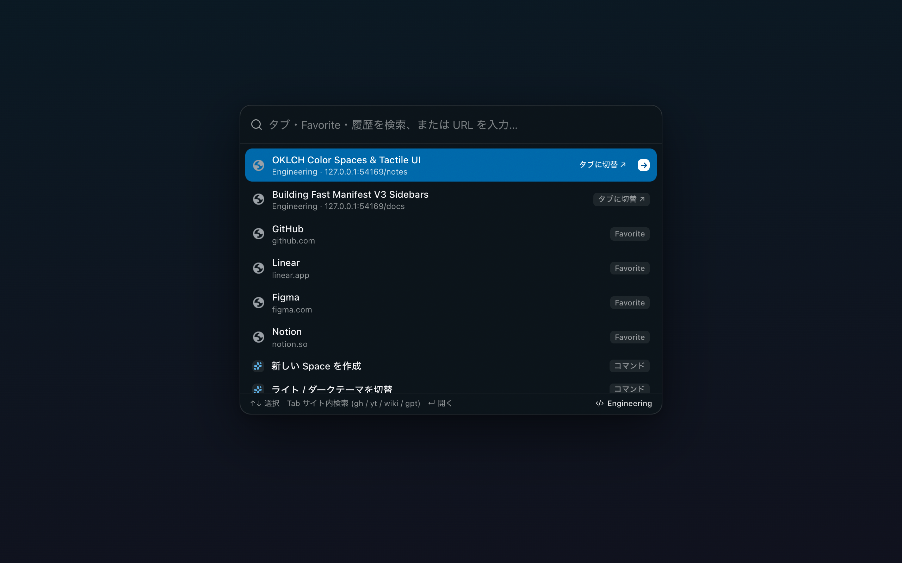
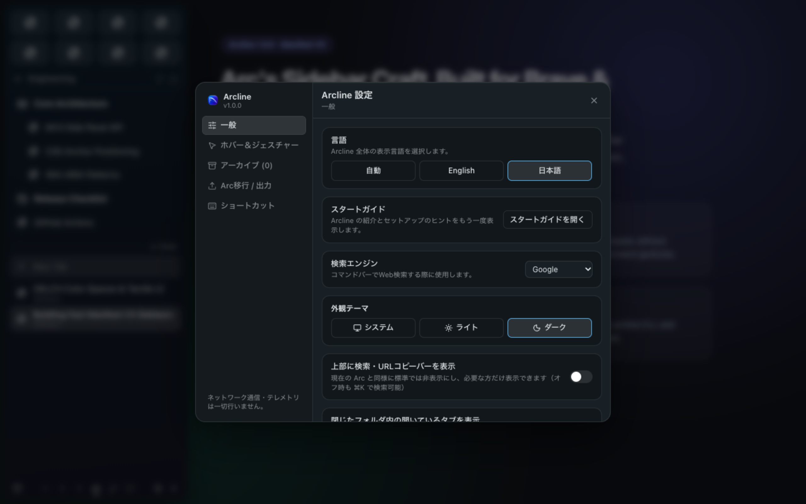
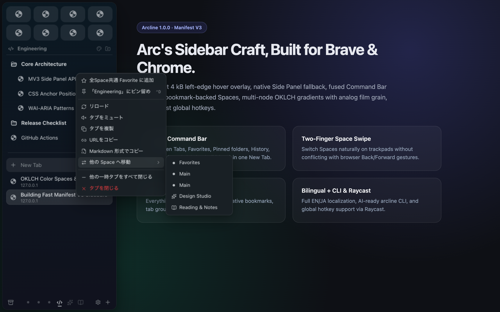
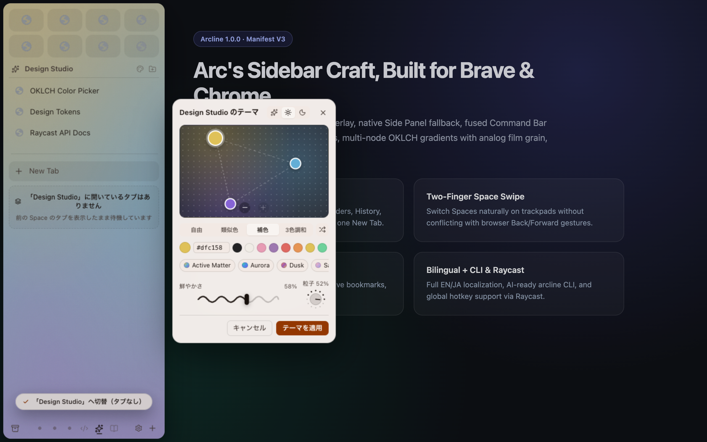
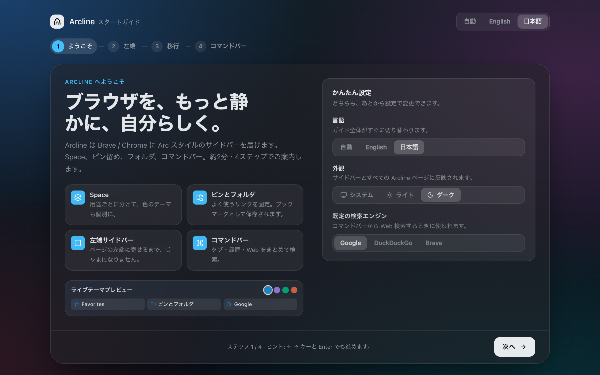

<div align="center">

# Arcline（アークライン）

**Arc Browser の洗練されたサイドバー・お気に入り＆履歴融合コマンドバー・Raycast グローバル起動を Brave / Chrome に。**

[](extension/public/manifest.json)
[](README.md)
[](LICENSE)

[**English README**](README.md) · [**日本語**](README.ja.md) · [**Raycast 拡張機能**](integrations/raycast/README.md#japanese) · [**AI 連携 CLI & Skill**](packages/arcline-cli/README.md) · [**llms.txt**](llms.txt) · [**プライバシーポリシー**](PRIVACY.md)

<br/>



</div>

---

## 主な機能とできること

**Arcline (`1.0.0`)** は、Arc Browser の生産性とデザイン性を、メモリ軽量・テレメトリゼロ・ローカル完結の Chrome / Brave MV3 拡張機能として再現したプロジェクトです。

| 機能 | できること |
| --- | --- |
| **左端ホバー自動表示オーバーレイ** | 普段は幅 **0px** で画面を一切邪魔せず、左端にカーソルを当てた瞬間だけすりガラスのサイドバーが出現。Web ページ側には React を一切読ませない超軽量 `overlay.js`（約 `4.5 kB` gzip）を採用し、`Cmd+` / `Cmd-` ズーム時でも UI サイズ不変・非アクティブタブでは自動メモリ解放を行います。 |
| **制限ページとのシームレス連携** | `brave://extensions` などの拡張スクリプト注入不可ページへタブ・Space を移動した際は、自動的に同サイズ（幅・6px マージン・角丸カード）のネイティブ Side Panel へ切り替わります（Web ページへ戻ると自動クローズ）。 |
| **Arc 風・統合コマンドバー新規タブ (`⌘T`)** | 新規タブを開くたびに、**開いているタブ（タブに切替 ↗）**・**全 Space 共通 Favorites**・**Space 別ピン留め/フォルダ**・**閲覧履歴**・**アーカイブ**・**クイックアクション**・**サイト内検索チップ（`g `, `gh `, `yt `, `wiki `, `gpt `, `pplx ` + `Tab`）** を 1 か所でファジー検索できます。 |
| **Favorites & Bookmark 同期 Spaces** | お気に入りと Space ごとのネストフォルダは標準ブックマーク（`その他のブックマーク / Arcline`）へ直接保存されるため、再起動やアップデートでもリンクが一切失われません。 |
| **2 本指スワイプ & テーマスタジオ** | サイドバー上でトラックパッドを 2 本指横スワイプすると、Web ページの戻る／進むと競合せずに即座に Space を往復可能。1〜3 色 OKLCH グラデーション、色の調和モード、フィルム粒子ノイズまで自在に編集できます。 |
| **日英バイリンガル & 初回スタートガイド** | `_locales/en`・`_locales/ja` とアプリ内ライブ言語切替に対応。初回インストール時に 4 ステップの導入ガイド（Brave 0px 設定・Arc インポート・ショートカット案内）が起動します。 |
| **どこからでも呼び出せるグローバル起動** | 他のアプリ（エディタやターミナル等）を使っていても、同梱の **[Raycast 拡張](integrations/raycast/README.md#japanese)** またはブラウザのグローバルショートカット（`open-command-bar`）から一瞬で Arcline 検索＆新規タブを起動できます。 |
| **AI エージェント連携 CLI & 専用 Skill** | 依存ライブラリゼロの **[arcline CLI](packages/arcline-cli/README.md)**（`--json` 出力）と **[専用 Agent Skill](skills/arcline/SKILL.md)** を同梱。AI エージェントが直接 Space の調査・履歴検索・JSON エクスポート・Arc 移行・新規タブ起動を行えます。 |

---

## スクリーンショット一覧（全機能ビジュアルガイド）

### 1. Arc 風・統合コマンドバー＆新規タブ（`⌘T`）
開いているタブ・お気に入り・ピン留め・履歴・サイト内検索チップを、アクティブ Space のテーマカラー背景上で即座に検索・切替できます。



### 2. ウィンドウ中央の設定画面 ＆ はみ出し右クリックメニュー
| 言語切替・検索エンジンも備えた設定モーダル | サイドバー幅を超えて展開する右クリックメニュー |
| --- | --- |
|  |  |

### 3. Space テーマスタジオ ＆ 4 ステップ導入ガイド
| 2D カラーオービット & 粒子ダイヤル | 初回インストール時の 4 ステップスタートガイド |
| --- | --- |
|  |  |

---

## どこにいてもグローバルホットキーで新規タブ／コマンドバー検索を使う方法

Chromium の仕様上、拡張機能マニフェスト既定のグローバルショートカットキーは `Ctrl+Shift+0〜9` 等の数字キーに制限されているため、Arcline では **2 つの方法** を用意しています：

### 方法 A: 同梱の Raycast Extension を使う（最も快適・おすすめ）
[integrations/raycast](integrations/raycast/README.md#japanese) を使えば、どのアプリを操作していても **`⌥ Space` や `⌘ ⇧ K` など好きなキー 1 つ** で即座に起動できます。

- **Search Arcline Command Bar**: Raycast 上で直接、Arcline のお気に入り・Space ピン留め・（ロック回避コピーによる高速な）ブラウザ履歴・`gh` / `yt` / `wiki` / `gpt` / `pplx` サイト検索を実行し、Enter でブラウザへジャンプ
- **Arcline Favorites**: 全 Space 共通のお気に入りを一覧表示し、個別の Raycast Quicklink を作成してグローバルホットキーを割当可能
- **Open Arcline New Tab**: 任意のアプリから即座に Brave / Chrome を前面化し、Arcline コマンドバー新規タブをオープン
- **Browse Arcline Spaces / Add Pin to Arcline Space**: Space 探索＆ピン追加

```bash
cd integrations/raycast
npm install && npm run build
```
その後 Raycast の **Import Extension** から `integrations/raycast` フォルダを読み込み、好みのグローバルホットキーを割り当ててください。

### 方法 B: ブラウザ組み込みのグローバルコマンドを設定する
`chrome://extensions/shortcuts`（Brave は `brave://extensions/shortcuts`）を開き、Arcline の **「どこからでも Arcline コマンドバーを開く」** のスコープを **「グローバル」** に変更してお好きなキーを登録すると、ブラウザが非アクティブのときやウィンドウが閉じているときでも新規タブ／ポップアップ検索を起動できます。

---

## AI エージェントに丸投げして CLI・Skill・Raycast を一括導入（コピペ用プロンプト）

**Claude Code / Codex / Cursor / Antigravity / Gemini CLI** に以下のプロンプトをそのまま貼り付けるだけで、環境を確認しながら Arcline の CLI（`@arcline/cli`）・Agent Skill（`skills/arcline`）・Raycast 拡張（`integrations/raycast`）をまとめて安全に導入できます。

```text
https://github.com/yama662607/Arcline の Arcline (1.0.0) CLI・Agent Skill・Raycast 拡張をこの環境に一括導入してください。

1. まずローカル環境を確認してください（OS、Node.js 22+ / Bun / pnpm / npm の有無、Raycast のインストール状況、利用中の AI エージェントのスキル配置先ディレクトリ）。
2. 標準ツール（`npx skills add yama662607/Arcline` または `gh skill install yama662607/Arcline`）で Arcline Agent Skill を導入してください。どちらも使えない場合はリポジトリをクローンし、`skills/arcline/` を検出したスキル配置先へコピーしてください。
3. `packages/arcline-cli` を導入・リンクし（`bun` または既存環境のパッケージマネージャを優先）、`arcline --help` と `arcline spaces --json` が動くことを確認してください。
4. macOS で Raycast がインストールされている場合は、`integrations/raycast` で `npm install && npm run build` を実行して「Search Arcline Command Bar」や「Arcline Favorites」を使える状態にし、Raycast の Import Extension 手順が必要なら案内してください。
5. 最後に読み取り専用の動作確認（`arcline doctor --json` と `arcline spaces --json`）を実行し、導入した内容と確認結果を報告してください。ブラウザのブックマークや個人データは一切変更しないでください。
```

### 標準ワンライナー（手動で導入する場合）

```bash
# 1. Agent Skill（どちらか一方を実行）
npx skills add yama662607/Arcline
gh skill install yama662607/Arcline

# 2. Arcline CLI（@arcline/cli・Node.js 22+・依存ライブラリゼロ）
git clone https://github.com/yama662607/Arcline.git && cd Arcline
bun link --cwd packages/arcline-cli   # または: npm link ./packages/arcline-cli
arcline --help && arcline spaces --json

# 3. Raycast 拡張（macOS / Windows）
cd integrations/raycast && npm install && npm run build
# 完了後、Raycast -> Import Extension から integrations/raycast を選択
```

---

## AI 連携 CLI ＆ 専用 Skill

AI アシスタント（Claude / Codex / Cursor / Antigravity / Gemini CLI 等）から Arcline のワークスペースを活用するためのゼロ依存 CLI（[packages/arcline-cli](packages/arcline-cli/README.md)）、専用スキル（[skills/arcline/SKILL.md](skills/arcline/SKILL.md)）、および [llms.txt](llms.txt) を同梱しています：

```bash
arcline doctor --json
arcline spaces --json
arcline search "論文" --history --json
arcline export --out arcline-context.json --json
```

*（グローバルリンクしない場合は `arcline` を `node packages/arcline-cli/bin/arcline.mjs` に置き換えて実行できます。）*

---

## 推奨 Brave 設定（ネイティブタブバーを完全 0px に隠す手順）

1. `brave://settings/appearance` の **タブ** セクションで：
   - **垂直タブを使用**: **ON**
   - **最小化時に完全に隠す**: **ON**
   - **右側に表示**: **ON**（ネイティブ垂直タブのホバー展開を右端 0px へ逃がし、画面左端を 100% Arcline 専用にするため）
2. 垂直タブを折りたたみボタンで最小化します（ブラウザ標準のタブ帯が完全 `0px` になります）。
3. **サイドパネルの位置** を **左** にしておくと、`brave://` ページでのフォールバックも左側に統一されます。

> **ヒント（タブグループ削除の確認ダイアログについて）:** Arcline は Space の構成・ピン留め・フォルダをブラウザのブックマークに保存しており、Tab Group は開いているタブのグルーピングのみに使用しています。Space の最後のタブを閉じたときに「タブグループも削除されます」という確認が出ても Space やピン留めは一切消えないため、**「今後表示しない（Don't ask again）」** にチェックを入れて閉じて問題ありません（または外観設定で「タブグループを自動的に保存する」を OFF にできます）。

---

## 開発・テスト・パッケージング

```bash
pnpm install
just check            # Biome format/lint + TypeScript 7 型チェック + Vitest (146 tests)
just build            # 本番 MV3 ビルド -> extension/dist/
just check-extension  # 実機 Brave 0エラー診断＋ライブ reload 2回
just e2e              # 実機 Playwright E2E テスト一式
just package          # Chrome Web Store 提出用 ZIP (release/arcline-1.0.0-cws.zip) を生成・検証
node --test packages/arcline-cli/test/cli.test.mjs  # CLI ユニットテスト (34 tests)
```

## プライバシー・ライセンス

## フィードバック・バグ報告

- **フィードバックフォーム（ログイン不要）**: [Google フォームから送る](https://docs.google.com/forms/d/e/1FAIpQLSdXf5b7sSiMUez01iu137XaH0u2D9kvgQLBIUUF4D4MRR7yIg/viewform)
- **バグ報告・機能リクエスト（GitHub）**: [GitHub Issues を開く](https://github.com/yama662607/Arcline/issues/new/choose)

Arcline は外部通信・テレメトリを一切行いません（詳細は [PRIVACY.md](PRIVACY.md) 参照）。ライセンスは GPL-3.0（[LICENSE](LICENSE)）です。
