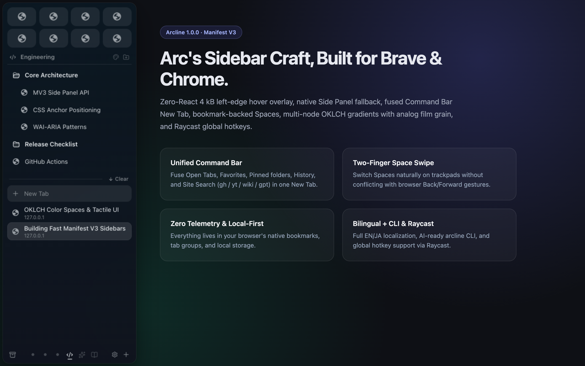
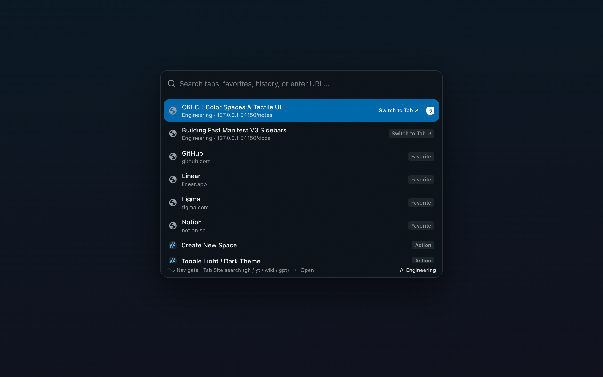
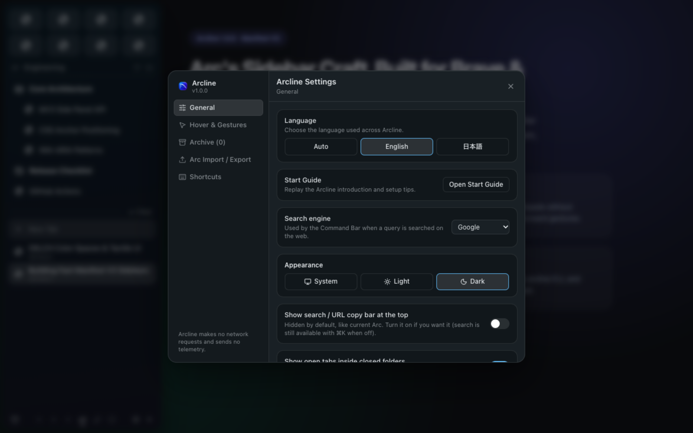
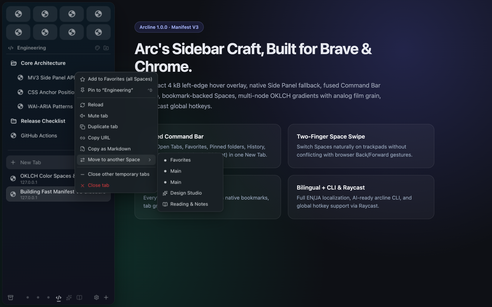
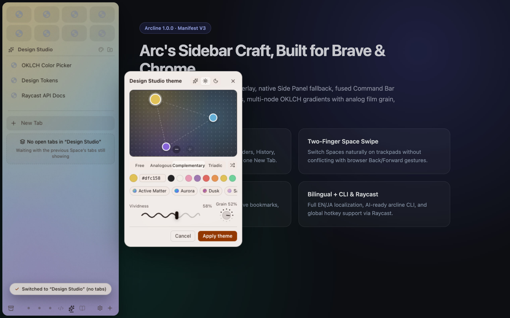
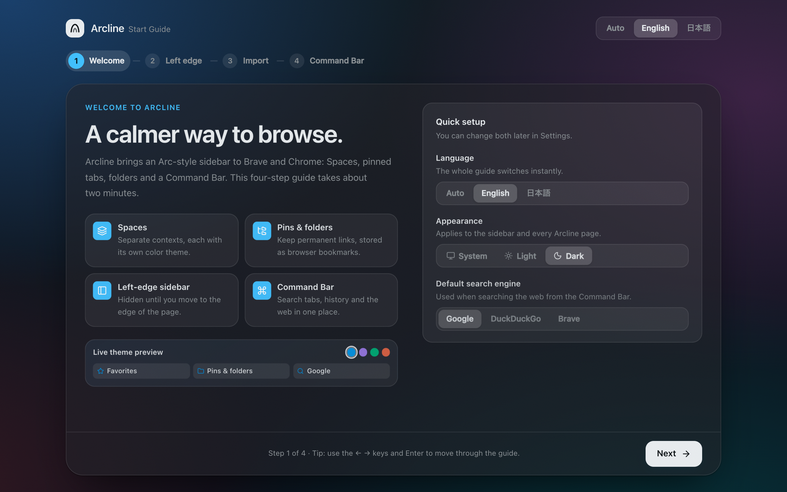

<div align="center">

# Arcline

**Arc's sidebar craft, unified Command Bar New Tab, and Raycast global launcher — built natively for Brave & Chrome.**

[](extension/public/manifest.json)
[](README.ja.md)
[](LICENSE)

[**English**](README.md) · [**日本語 (README.ja.md)**](README.ja.md) · [**Raycast Extension**](integrations/raycast/README.md) · [**CLI & AI Skill**](packages/arcline-cli/README.md) · [**llms.txt**](llms.txt) · [**Privacy Policy**](PRIVACY.md)

<br/>



</div>

---

## Why Arcline?

Arcline recreates the signature workflow of **Arc Browser** inside Chrome, Brave, and Chromium without high RAM overhead or data lock-in:

| Capability | What You Get |
| --- | --- |
| **Auto-Hide Left-Edge Overlay** | Occupies **0 px** until your cursor dwells on the left edge (`~4.5 kB` gzip Vanilla JS `overlay.js`, zero React overhead on websites). Lazy-loads the sidebar `iframe` on demand, resists cross-monitor fly-bys, stays zoom-invariant across `Cmd+`/`Cmd-`, and unloads idle background tabs automatically. |
| **Native Side Panel Sync** | On `chrome://`, `brave://`, and restricted pages, falls back cleanly to Chrome's native Side Panel with matching `6 px` margin card styling and width (`Ctrl+B`), closing automatically when returning to normal web pages. |
| **Arc-Style Unified Command Bar** | Every New Tab (`⌘T`) becomes a keyboard-first fuzzy search bar that fuses **Open Tabs** (`Switch to Tab ↗`), **Favorites**, **Space Pinned Links/Folders**, **Browser History**, **Archived Tabs**, **Quick Actions**, and colored **Site Search chips** (`g `, `gh `, `yt `, `wiki `, `gpt `, `pplx ` + `Tab`). |
| **Global Favorites & Bookmark Spaces** | Favorites and nested Space folders live natively under `Other Bookmarks / Arcline` — surviving browser restarts, updates, and reinstalls with zero data loss. |
| **Trackpad Swipe & Space Theme Studio** | Two-finger horizontal swipe over the sidebar glides between Spaces with instant reverse-swipe and zero Back/Forward history conflict. Customize multi-node (1–3 color) OKLCH gradients, color harmony, vibrancy, and analog film grain. |
| **Bilingual EN / JA + 4-Step Start Guide** | Full English & Japanese UI (`_locales/en` & `_locales/ja`, live toggleable) with a guided first-install interactive walkthrough (`onboarding.html`). |
| **Global Hotkeys (Raycast + Native)** | Summon the Command Bar, browse Spaces, jump to a New Tab, or save a Pin from **any macOS app** via the included [Raycast Extension](integrations/raycast/README.md) or Chromium's global shortcut (`open-command-bar`). |
| **AI-Ready CLI & Agent Skill** | Zero-dependency [arcline CLI](packages/arcline-cli/README.md) (`--json` mode) + dedicated [Agent Skill](skills/arcline/SKILL.md) lets AI agents inspect Spaces, search bookmarks & copied-DB history, export context, and import Arc's `StorableSidebar.json`. |

---

## Visual Tour

### 1. Unified Command Bar & New Tab (`⌘T`)
Fuses open tabs, Global Favorites, Space pins, browsing history, quick browser commands, and colored site-search chips over your Space's live OKLCH gradient.



### 2. Window-Centered Modals & Context Menus
| Window-Centered Bilingual Settings | Overflowing Context Menus & Space Submenus |
| --- | --- |
|  |  |

### 3. Space Theme Studio & 4-Step Interactive Start Guide
| Space Theme Studio (Live OKLCH Orbit + Film Grain) | Interactive 4-Step First-Install Start Guide |
| --- | --- |
|  |  |

---

## Global Hotkeys Everywhere (Raycast + Browser)

Because Chromium restricts MV3 extension `suggested_key` global shortcuts to `0-9` digit combinations, Arcline gives you two ways to summon the Command Bar from **any application**:

1. **Raycast Extension (Recommended on macOS / Windows)**: [integrations/raycast](integrations/raycast/README.md)
   - Bind any comfortable global hotkey (such as `⌥ Space`, `⌥ T`, or `⌘ ⇧ K`) directly to:
     - **Search Arcline Command Bar**: Instantly search Favorites, Space Pins, Browser History, and `gh`/`yt`/`wiki`/`gpt`/`pplx` Site Search without even switching apps.
     - **Arcline Favorites**: List all Global Favorites and generate individual Raycast Quicklinks for instant global hotkeys.
     - **Open Arcline New Tab**: Focus Brave/Chrome from anywhere and open an Arcline Command Bar tab immediately.
     - **Browse Arcline Spaces** & **Add Pin to Arcline Space**.
   - Setup:
     ```bash
     cd integrations/raycast
     npm install && npm run build
     ```
     Then in Raycast, run **Import Extension** and select `integrations/raycast`.

2. **Built-in Chromium Global Command (`open-command-bar`)**:
   - Open `chrome://extensions/shortcuts` (or `brave://extensions/shortcuts`), find **Open Arcline Command Bar from anywhere**, set Scope to **Global**, and record your shortcut. Works even when the browser window is unfocused or closed (opens a centered popup).

---

## Install CLI, Agent Skill & Raycast with Your AI Agent (Copy-Paste Prompt)

Paste this prompt into **Claude Code, Codex, Cursor, Antigravity, or Gemini CLI** to automatically inspect your machine and install Arcline's CLI (`@arcline/cli`), Agent Skill (`skills/arcline`), and Raycast extension (`integrations/raycast`):

```text
Install Arcline (1.0.0) CLI, Agent Skill, and Raycast extension from https://github.com/yama662607/Arcline on my machine:

1. Inspect my local environment first: OS, Node.js (22+), Bun/pnpm/npm availability, whether Raycast is installed, and which local AI agent skill directories exist.
2. Install the Arcline Agent Skill using `npx skills add yama662607/Arcline` or `gh skill install yama662607/Arcline` (if neither is available, clone the repo and copy `skills/arcline/` into my detected agent skills directory).
3. Install/link `packages/arcline-cli` (preferring `bun` or my existing package manager) and verify `arcline --help` and `arcline spaces --json`.
4. If I am on macOS and Raycast is installed, build `integrations/raycast` (`npm install && npm run build`) so "Search Arcline Command Bar" and "Arcline Favorites" are ready in Raycast, and tell me if I need to run Raycast's "Import Extension" step.
5. Run a read-only verification check (`arcline doctor --json` and `arcline spaces --json`) and report exactly what was installed. Do NOT modify any browser bookmarks or personal data.
```

### Standard One-Liners (Manual Install)

```bash
# 1. Agent Skill (choose either)
npx skills add yama662607/Arcline
gh skill install yama662607/Arcline

# 2. Arcline CLI (@arcline/cli, Node.js 22+, zero dependencies)
git clone https://github.com/yama662607/Arcline.git && cd Arcline
bun link --cwd packages/arcline-cli   # or: npm link ./packages/arcline-cli
arcline --help && arcline spaces --json

# 3. Raycast Extension (macOS / Windows)
cd integrations/raycast && npm install && npm run build
# Then open Raycast -> Import Extension -> select integrations/raycast
```

---

## AI Integration CLI (`arcline`) & Agent Skill

Arcline ships a zero-dependency Node.js 22+ CLI ([packages/arcline-cli](packages/arcline-cli/README.md)), an Agent Skill ([skills/arcline/SKILL.md](skills/arcline/SKILL.md)), and an [llms.txt](llms.txt) index designed for coding & research agents (`--json` envelopes everywhere):

```bash
arcline doctor --json
arcline spaces --json
arcline search "kubernetes" --history --json
arcline export --out arcline-context.json --json
arcline import-arc --file ~/Library/Application\ Support/Arc/StorableSidebar.json --json
```

*(Without linking globally, replace `arcline` with `node packages/arcline-cli/bin/arcline.mjs`.)*

---

## Recommended Brave Setup (`0 px` Native Tab Bar)

1. Open Brave **Settings → Appearance → Tabs**:
   - Enable **Use vertical tabs**
   - Enable **Hide completely when minimized**
   - Select **Show on the right** (frees 100% of the left screen edge for Arcline's auto-hide overlay)
2. Collapse the vertical tab bar (`0 px` native tabs).
3. Set **Side panel position** to **Left** so internal `brave://` pages open Arcline on the left.

> **Tip (Tab Group delete prompt):** Arcline stores Spaces, pinned links, and folders in your browser Bookmarks and uses native Tab Groups only for live open tabs. If Chrome or Brave prompts *"Delete tab group?"* when closing the last tab in a Space, your Space and pins are completely safe—check **Don't ask again** (or turn off *Automatically save tab groups* in Appearance settings).

---

## Development & Release

Requirements: Node.js 22+, `pnpm` 9+, `just` (optional).

```bash
pnpm install
just check            # Biome format/lint + TypeScript 7 typecheck + Vitest (146 tests)
just build            # MV3 bundle -> extension/dist/ (sidepanel, command bar newtab, onboarding, SW, IIFE overlay.js)
just check-extension  # Real-browser chrome.developerPrivate 0-error diagnostics + 2x reload
just e2e              # Real-browser Playwright E2E suite (Brave / Chromium)
just package          # Validate manifest/_locales/IIFE and build release/arcline-1.0.0-cws.zip
node --test packages/arcline-cli/test/cli.test.mjs  # 34 CLI unit tests
```

## Privacy

Arcline makes **zero outbound network requests** and collects **zero telemetry**. Bookmarks, themes, history queries, and archives stay 100% on your device. See [PRIVACY.md](PRIVACY.md) and [CHROMEWEBSTORE.md](CHROMEWEBSTORE.md).

## License

## Feedback & Support

- **Quick Feedback Form (no login required)**: [Submit via Google Form](https://docs.google.com/forms/d/e/1FAIpQLSdXf5b7sSiMUez01iu137XaH0u2D9kvgQLBIUUF4D4MRR7yIg/viewform)
- **Bug Reports & Feature Requests (GitHub)**: [Open an Issue](https://github.com/yama662607/Arcline/issues/new/choose)

## License

GPL-3.0 — see [LICENSE](LICENSE).
